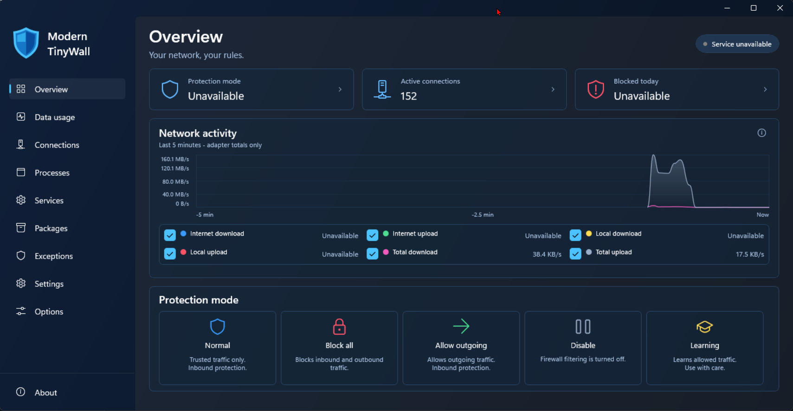

### Please note that this is an experimental work in progress. Modern TinyWall runs on WinUI 3/.NET 10, along with TinyWall that runs on WinForms/.NET 10. The application responsiveness of Modern TinyWall already surpasses legacy TinyWall.

[](https://github.com/ShirazAdam/TinyWall/actions/workflows/dotnet-desktop.yml)

[](https://github.com/ShirazAdam/TinyWall/actions/workflows/dependency-graph/auto-submission)

[](https://github.com/ShirazAdam/TinyWall/actions/workflows/github-code-scanning/codeql)

[](https://github.com/ShirazAdam/TinyWall/actions/workflows/dependabot/dependabot-updates)

# TinyWall / Modern TinyWall

Both applications and their shipped libraries use version **4.5.3**. The release workflow validates that these versions match and creates the matching GitHub tag (`4.5.3`) when the changes are pushed to `master` and its builds pass.



*The running application, not a design mock-up. This screenshot was taken without the TinyWall service installed: protection status and classified Internet/local traffic are unavailable, while live adapter totals and established TCP connection counts remain visible. “Blocked today” is unavailable because complete daily blocked-connection history is not provided.*

## What's new in Modern TinyWall

- **A refreshed Windows interface:** shield branding, an integrated title bar, coordinated cards and outlined protection-mode tiles. Colours follow Windows light/dark mode, with system colours for contrast themes.
- **A compact Overview:** protection status, established TCP connection counts, a five-minute traffic chart and all five protection modes. The selected mode reflects verified service state, not an assumed default.
- **Six selectable traffic series:** Internet, local and total upload/download, with smooth filled curves, automatic scaling and an inline legend. Selections are saved immediately and survive restarts.
- **Subtle motion:** animated navigation, page fades and protection-tile hover effects, respecting Windows animation settings. Dashboard sampling pauses while hidden or minimised.
- **Improved Connections:** aligned columns, horizontal scrolling on narrower windows, and **Filter/Refresh** from either the button or Enter/Return in the search box.

The TinyWall service is still required for firewall control and classified traffic tracking. Without it, the dashboard clearly reports unavailable service data and labels total rates as adapter traffic.

TinyWall is a free, lightweight and non-intrusive firewall for Windows. It is designed to harden the built-in Windows Firewall while keeping day-to-day use simple: no drivers required by default and no unnecessary background clutter. Modern TinyWall shows a decision prompt when it detects a blocked outbound connection from an application that has not already been approved.

The original project suffered from a lack of updates and support. The original project also suffers from performance problems where right-clicking on the tray icon can take anywhere between 2 - 12 seconds to show the context menu. Some forms can also freeze because expensive work runs on the UI thread. This fork aims to experiment and continue the development of TinyWall, keeping it up-to-date and compatible with the latest Windows versions, while also adding new features and improvements.

This repository now contains both the legacy TinyWall application and a new **Modern TinyWall** application. Modern TinyWall is a .NET 10 Windows desktop client that modernises the user experience while reusing the existing firewall, Windows integration, package discovery, service-control, and Windows Filtering Platform functionality where practical. The goal is to keep the proven TinyWall behaviour while improving responsiveness, maintainability, and compatibility with current Windows and .NET releases.

The applications provide tray-based control for managing firewall modes, application exceptions, service and process rules, Microsoft Store / packaged app rules, connection activity, blocklists, and firewall log entries. They help users allow trusted applications, block unwanted network access, and review network activity without needing to edit Windows Firewall rules manually.

Modern TinyWall uses WinUI 3 dialogs. The legacy WinForms application uses the built-in .NET Windows Task Dialog API, replacing the former third-party wrapper while retaining its prompts, command-link choices, expandable details, progress indicators, and cancellation options.

Modern TinyWall uses WinUI's animated sidebar selection indicator and fades between views. Navigation animations follow the Windows animation setting and do not run while the window is hidden or minimised.

The refreshed shell and Overview follow the design reference with a shield wordmark, a seamless title bar, coordinated navy surfaces in Windows dark mode and pale blue/white surfaces in light mode, switching with the system theme. Contrast themes use system colours. The compact dashboard has three summary cards, a filled traffic chart with an inline two-row legend, and five outlined protection tiles. Verified service state determines the protection badge and selected tile; unavailable service state never appears as active protection. Active connections counts established IPv4/IPv6 TCP connections. The **Blocked today** card explicitly shows **Unavailable**, because the service does not provide complete daily blocked-connection history. Summary cards lead to protection modes or Connections. Traffic status details are available from the chart's information button; the subtitle identifies adapter-only totals when classified tracking is unavailable.

The window initially fits the reference proportions within the current monitor's work area. Shorter or narrower windows use a shorter chart, reflowed cards/legend and scrolling rather than clipping controls. Protection tiles have subtle hover lift, disabled when Windows animations are off or a contrast theme is active.

The Connections view keeps headers and results aligned, with horizontal scrolling on narrower windows. Press Enter/Return in the search box or select **Filter/Refresh** to reload results using the search text and selected connection types.

The Overview traffic chart uses the same TCP/UDP tracking and Internet/local classification as Data usage. It shows Internet download (blue) and upload (green), local download (yellow) and upload (red), and combined download (pink) and upload (grey). Each smooth curve has a translucent fill down to zero; classified totals are Internet plus local traffic, not additional traffic. Tick the series labels to show any combination, including all six or none. Selections are saved immediately and restored after restarting the application. Rates are calculated from elapsed time between snapshots, with an automatic bandwidth scale based on visible series and five-minute history. Sampling pauses while hidden or minimised. If the service is unavailable, the chart reports the error, marks classified traffic unavailable, and shows adapter counters for total traffic instead; adapter totals can include traffic excluded from classified TCP/UDP tracking.

For Release builds, install `ModernTinyWall.exe` in the same directory as the matching `TinyWall.exe` service binary. The service checks executable paths and accepts only the legacy executable and this colocated modern client; clients from other directories are rejected. Because this check trusts those paths, the installation directory and its executables must not be writable by unprivileged users. The service must be running for classified traffic tracking.

Modern TinyWall's outbound connection prompt displays the application's name, icon, executable path, protocol, and destination. Users can allow the destination for five minutes, always allow the application, deny the attempt, or always block the application. The initial connection attempt is blocked before the prompt appears, so the application may need to retry after it is allowed. Existing approved rules continue to work without prompting.

### Experimental pending-connection driver

`TinyWall.Driver` adds an opt-in Windows Filtering Platform callout for holding unapproved outbound TCP and UDP connections while Modern TinyWall asks for a decision. TCP authorization is pended; UDP additionally clones the initial datagram and reinjects it after approval. IPv4 and IPv6 are supported by the source implementation. Existing permits, explicit blocks, and blocklist rules take precedence. This path applies only in Normal mode and is not enabled during display-off blocking.

**This path is experimental and has not been runtime-tested.** It is disabled by default; Modern TinyWall exposes an experimental toggle under Machine settings. The regular installer does not install a driver, and installing the WDK alone does not enable this feature. Only enable it on an isolated test VM after separately installing a suitably signed driver and arranging debugging and recovery. If the driver is unavailable when TinyWall starts, the service logs the failure, disables the opt-in setting and uses the ordinary firewall rules instead. Production driver signing and distribution are not included.

The driver exposes a system/administrator-only device interface, bounds the queue to 128 requests, and denies unanswered requests after two minutes. Modern TinyWall continues polling while a dialog is open. Loss of the polling client denies pending requests after a ten-second heartbeat grace period. Full queues, unsupported packet forms (such as raw sockets), or failures remain blocked rather than receiving a temporary blanket permit.

Applications can still cancel or time out their own requests while a prompt is open. Approving a request cannot revive a socket that the application has already closed.
Allow decisions are submitted to the driver before the corresponding rule is saved, so that the rule does not bypass the pending callout. If the decision cannot be confirmed, no allow rule is saved; the connection may nevertheless already have been processed. If saving the rule subsequently fails, the connection may already have been authorised and the error is shown. Other policy changes, reauthorisation and UDP reinjection remain unvalidated; do not rely on this experimental feature for production protection.

Build the unsigned driver artifact from a Visual Studio developer command prompt with the C++ tools, matching Windows SDK, and WDK installed:

```powershell
msbuild TinyWall.Driver\TinyWall.Driver.vcxproj /p:Configuration=Debug /p:Platform=x64
```

The project defaults to SDK/WDK `10.0.28000.0`; override `WindowsTargetPlatformVersion` when using another matching SDK/WDK. `Release` and `ARM64` configurations are also available. Compilation stages an **unsigned, unvalidated** INF, driver and VM-only management script under `TinyWall.Driver\bin\<platform>\<configuration>\package`. It does not install or load the driver.

Before VM installation, generate the catalog for the target Windows version and architecture with the WDK's Inf2Cat, and sign the driver and catalog with an appropriate test certificate. Configure test signing and certificate trust **only in the disposable VM**, following Microsoft's [test-signing guidance](https://learn.microsoft.com/windows-hardware/drivers/install/test-signing-driver-packages). These steps require separately supplied signing credentials; the repository contains none. Production deployment requires the applicable Microsoft kernel-driver signing process.

On the isolated Hyper-V VM, use an elevated 64-bit PowerShell session in the signed package directory and run `.\Manage-TestDriver.ps1 -Action Install -IsolatedHyperVTestVm`. Restart the VM, confirm the driver is running, then enable the experimental setting. The script checks for Hyper-V and requests confirmation before making changes. To remove it, first disable the setting, stop the TinyWall service, then run `.\Manage-TestDriver.ps1 -Action Uninstall -IsolatedHyperVTestVm` with the same package and restart if requested. The installer and removal workflow themselves remain unvalidated.

Runtime validation is deferred to a separate Windows 11 Hyper-V VM and must cover TCP/UDP on both IP versions, all decisions, timeouts, client/service exits, policy changes, signing, installation and driver unload.

TinyWall and Modern TinyWall focus on being practical and low-overhead. They use Windows networking and security features rather than replacing them, and aim to keep the user interface responsive while doing heavier discovery and rule-management work in the background.

Now enabled to run natively on x86, x64, and ARM.

## Application data usage

Modern TinyWall's **Data usage** view, immediately after Overview, lists applications with recorded TCP/UDP traffic. It shows Total, Internet incoming/outgoing, and Local incoming/outgoing bytes, with search, sorting, and Today, Last 7 days, Last 30 days, and All time filters. The last-7/30-day filters include today and use the machine's local calendar days. Totals combine multiple instances of the same executable path and remain visible after those applications exit.

The **updated TinyWall service must be installed and running**. Its privileged Windows ETW collector runs independently of the UI; the UI does not need administrator access just to read usage. Daily aggregates are committed to SQLite at `%ProgramData%\TinyWall\data-usage.db` every five seconds and on normal service shutdown. No packet contents or remote-address history are stored. History begins when collection starts, not retroactively. A crash or forced shutdown can lose the most recent uncommitted batch.

Local means private, loopback, link-local, IPv6 unique/site-local, shared-address (`100.64.0.0/10`), and multicast/broadcast addresses. Public remote addresses count as Internet. This is address-based, so private-address VPN traffic counts as Local and VPN/tunnel overhead may be attributed separately. ETW TCP/UDP byte sizes are not billing-grade interface counters: they do not include all link-layer overhead, retransmission events, or other protocols. Loopback traffic can count on both the sending and receiving application.

Shared hosts such as `svchost.exe` are grouped by executable, not separated into services; packaged applications are also identified by their executable path. System traffic has a System row. Events whose executable cannot be resolved (for example, a protected or already-exited process) have an explicit Unattributed traffic row rather than being silently discarded. Collection failures, detected ETW event loss, and interrupted collection are surfaced in the view; incomplete-history warnings persist across service restarts. Period totals only include times when the service was recording.

## Current development focus

- Targeting .NET 10 for the actively modernised projects.
- Adding the new `ModernTinyWall` desktop client alongside the existing `TinyWall` application.
- Moving expensive UI-triggered operations off the UI thread where possible.
- Improving tray responsiveness and modernising tray command handling.
- Preserving existing TinyWall firewall behaviour while modernising the surrounding application code.
- Prompting users about blocked outbound connections from unapproved applications.
- Keeping native Windows interop explicit and source-generator friendly for modern .NET builds.

You're welcome to hack and slash at it. Enjoy!

#### Hosted on

 - GitHub -> <https://github.com/ShirazAdam/Tinywall>

## How to build

### Necessary tools

- [Microsoft Visual Studio 2026](https://visualstudio.microsoft.com/vs/)
- [.NET 10](https://dotnet.microsoft.com/download/dotnet/10.0)
- The [Visual Studio Installer Projects extension](https://marketplace.visualstudio.com/items?itemName=VisualStudioClient.MicrosoftVisualStudio2022InstallerProjects) is needed only to build the legacy `TinyWallSetup` project.
- [Inno Setup 6 or later](https://jrsoftware.org/isinfo.php) is needed to build installers using the current packaging scripts.

### To build the application

1. Open `TinyWall.slnx` in Visual Studio.
1. Build `ModernTinyWall` to run the modern WinUI 3 client, or build `TinyWall` to run the legacy WinForms application.
1. Visual Studio builds the referenced projects automatically.

### To build an installer

The current Inno Setup packaging workflow publishes the `TinyWall` application for x86, x64, and ARM64, then builds an architecture-specific installer. Follow the commands in [`installer/README.md`](installer/README.md). The older `TinyWallSetup` Visual Studio project remains in the solution but is not the primary installer path.

### Main projects

- `ModernTinyWall` - modern .NET 10 Windows desktop client.
- `TinyWall` - original / legacy TinyWall application.
- `TinyWall.Core` - shared core functionality.
- `TinyWall.Shared` - shared source files compiled by both clients.
- `TinyWall.Driver` - separate experimental WDK project for pending outbound authorization.
- `ModernTinyWall.Windows` - Windows platform helpers and native interop wrappers.
- `ModernTinyWall.Windows.WFP` - Windows Filtering Platform integration.
- `ModernTinyWall.Windows.Services` - Windows service-control helpers.
- `ModernTinyWall.Utilities` - shared utility code for the modernised projects.

### To run automated tests

Run the Modern TinyWall exception-store and data-usage tests from the repository root:

```powershell
dotnet test ModernTinyWall.Exceptions.Tests\ModernTinyWall.Exceptions.Tests.csproj
```

The `LiveETW` data-usage smoke test requires an elevated Windows test process; otherwise it is skipped. It records IPv4/IPv6 loopback traffic in a temporary database without modifying the installed service. Release builds store usage in ProgramData; Debug builds follow TinyWall's existing application-directory data location.

### To update/build build the database of known applications

1. Adjust the individual JSON files in the `TinyWall\Database` folder.
1. Start the application with the `/develtool` flag.
1. Use the `Database creator` tab to create one combined database file in JSON format. The output file will be called `profiles.json`.
1. To use the new database in debug builds, copy the output file to the `TinyWall\bin\Debug` folder.
1. Done.

## Contributing

Please feel free to contribute to the project. Fork the repository, make your changes and submit a pull request. All contributions are welcome, whether it's fixing bugs, adding new features, improving documentation, or anything else you think would benefit the project.

## Licence

- All other code and artefacts in the repository are under the DO WHAT THE F*** YOU WANT TO PUBLIC LICENCE. See `LICENCE.txt` for more information.
